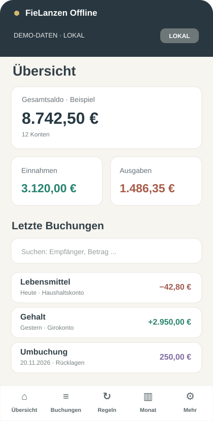
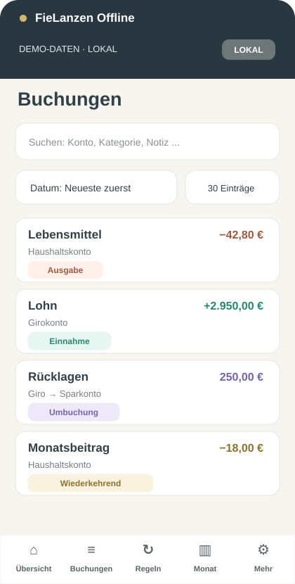
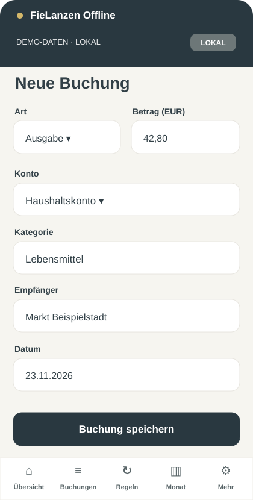

# FieLanzen Offline · Android

[English](README.md) | **Deutsch**

<p align="center">
  
</p>

<p align="center"><strong>Eigenständige Android-Finanzverwaltung – zuerst lokal, optional mit Dashboard-Verbindung.</strong></p>

**Aktueller Quellstand:** `0.1.0-alpha.28` · **Entwicklungsstand:** Alpha · **Android-Paketkennung:** `de.fielanzen.offline`

FieLanzen Offline ist eine eigenständige Android-App auf Basis von **TypeScript, Capacitor und SQLite**. Konten, Empfänger, Kategorien, Buchungen, Umbuchungen, Wiederholungsregeln und Auswertungen funktionieren ohne Server. Ein optionaler, ausdrücklich aktivierter Servermodus nutzt die Mobile-API des getrennt entwickelten [FieLanzen/Financisto-Dashboards](https://github.com/renfie/financisto-dashboard). Die Datenquellen werden **nicht automatisch zusammengeführt oder synchronisiert**.

## Einblicke

> **Illustrative Beispielansichten mit erfundenen Finanzdaten, keine echten Bildschirmfotos oder privaten Kontodaten.** Die Darstellung kann sich in Alpha-Versionen unterscheiden.

| Übersicht | Buchungen | Neue Buchung |
| :---: | :---: | :---: |
|  |  |  |

## Funktionen

- **Eigenständiger Offline-Modus** mit Konten, Buchungen, Empfängern, Kategorien, Umbuchungen und wiederkehrenden Buchungen.
- **Financisto-Kompatibilität:** `.backup`-Dateien prüfen/importieren; Buchungen und lokal vorhandene Terminregeln ohne separaten Exportschalter ausgeben.
- **Datensicherung:** Vollständige FieLanzen-JSON-Sicherung und Wiederherstellung sowie native Sicherungsfunktionen. JSON ist für App-spezifische Daten das verlustfreie Sicherungsformat.
- **Optionaler Servermodus:** Verbindungsprüfung und ausdrückliche Bestätigung, Wechsel zurück auf lokale Daten ohne automatische Übernahme von Serverbuchungen.
- **Übersicht und Listen:** Suche, Sortierung, Standardanzeige 30/50/100 und Nachladen. Im Servermodus zunächst Suche in geladenen API-Seiten.
- **Android-Schutz:** Optionale App-Sperre mit Fingerabdruck/Geräte-PIN, Android Keystore für API-Schlüssel und sichere Abstände zu Systemleisten.

## Debug-APK unter Debian/Ubuntu erstellen

Benötigt werden Node.js 22+, Java 21 und ein Android SDK. Das VM-Skript kann fehlende Werkzeuge einrichten. Im Projektverzeichnis:

```bash
bash scripts/build-android-vm.sh
```

Nach einem erfolgreichen Build liegt die APK unter `release/FieLanzen-Offline-0.1.0-alpha.28-debug.apk`. Das Skript lädt nichts zu GitHub hoch und verändert das Dashboard nicht.

**Vor jedem Update:** Vollständige JSON-Sicherung außerhalb der App erstellen. Zur Aktualisierung müssen **Paketkennung und Signaturschlüssel identisch** sein. Nicht deinstallieren und keine App-Daten löschen, um einen Signaturfehler zu umgehen. Siehe [VM-Anleitung](ANLEITUNG-ANDROID-DEBIAN.txt) und [Installationsanleitung](docs/INSTALLATION.de.md).

## Entwicklung und Tests

```bash
npm install
npm run build
npx tsc -p tsconfig.preview.json
node --test tests/alpha26-full-backup.test.mjs tests/alpha27-display-lock.test.mjs tests/alpha28-home-search-safearea.test.mjs
```

Die gezielten Quellcodeprüfungen ersetzen weder den vollständigen Android-Build noch den Test auf einem echten Gerät. Die historischen Tests enthalten teilweise veraltete Annahmen.

## Zwei Projekte, zwei Versionierungen

| Android-App (dieses Repository) | [Dashboard](https://github.com/renfie/financisto-dashboard) |
| --- | --- |
| Capacitor, SQLite, lokale Sicherung, Android-Oberfläche & Mobile-API-Client | Docker-Webanwendung, Server-API, Datenbank & Updateskripte |
| Android-Versionen `0.1.0-alpha.*` | Dashboard-Versionen `1.9.*` |
| Änderungen an der Android-App **hier** | Änderungen am Server **dort** |

## Dokumentation

- [English README](README.md)
- [Entwicklung](docs/ENTWICKLUNG.md) · [English](docs/DEVELOPMENT.en.md)
- [Sicherheit und Datenschutz](docs/SICHERHEIT.md) · [English](docs/SECURITY.en.md)
- [Änderungsverlauf (DE)](CHANGELOG-OFFLINE.md) · [Change log (EN)](CHANGELOG-OFFLINE.en.md)
- [Hinweise zur Dashboard-Mobile-API](docs/DASHBOARD-MOBILE-API.md)

## Datenschutz, Lizenz und Herkunft

Keine echten Finanzdaten, `.backup`-Dateien, Datenbanken, API-Schlüssel, Client-Zertifikate, Signaturschlüssel, ausgefüllte `.env`-Dateien oder identifizierende Bildschirmfotos veröffentlichen. JSON- und Financisto-Sicherungen sind **nicht automatisch verschlüsselt**, auch wenn die App-Sperre aktiv ist. Beispiel-URLs verwenden `example.org`.

Eigene Projektbestandteile stehen unter [GPL-2.0-only](LICENSE); Hinweise zu Dritten in [NOTICE.md](NOTICE.md). Dieses Projekt ist **keine** offizielle Financisto-Version oder -Fortsetzung. Verfügbarer Quellcode bedeutet nicht, dass eine fertige APK vollständig auf Android getestet ist.
