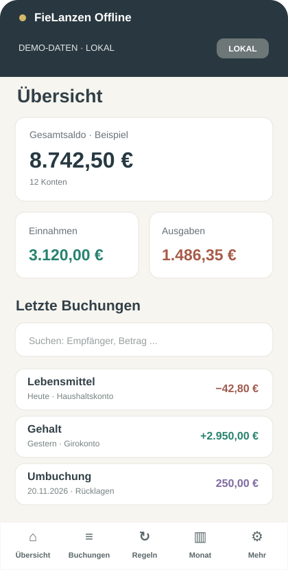
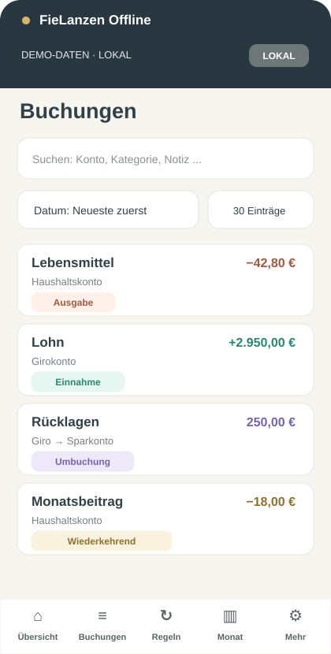
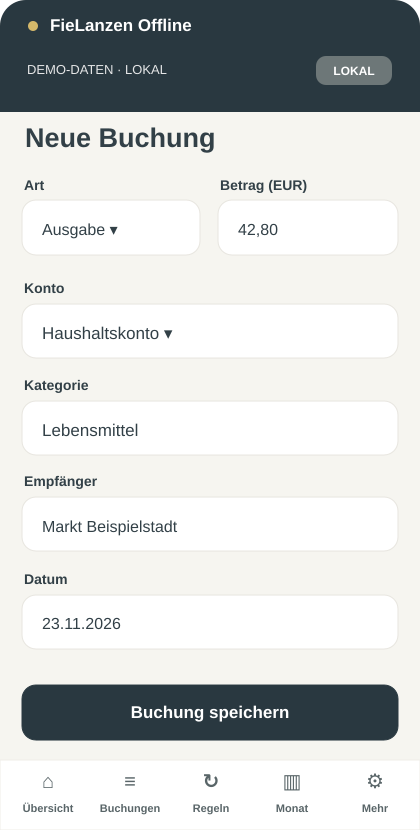

# FieLanzen Offline · Android

**English** | [Deutsch](README.de.md)

<p align="center">
  
</p>

<p align="center"><strong>A standalone Android personal-finance app — local first, optional dashboard connection.</strong></p>

**Copyright © 2026 René Fieler (RenFie)** · Licensed under [GNU GPL v2 only](LICENSE).

**Current source version (`developer`):** `0.1.0-alpha.37` · **Development status:** alpha · **Android package ID:** `de.fielanzen.offline`

FieLanzen Offline is a separate Android application built with **TypeScript, Capacitor and SQLite**. Accounts, payees, categories, bookings, transfers, recurring rules and reports can be managed on the phone without a server. A separately enabled server mode connects to the [FieLanzen/Financisto Dashboard](https://github.com/renfie/financisto-dashboard) through its Mobile API. The two data sources are **not silently merged or synchronized**.

## Preview

> **Illustrative UI mockups with fictional finance data, not real screenshots or user account data.** Actual layouts may differ in alpha builds.

| Overview | Bookings | New booking |
| :---: | :---: | :---: |
|  |  |  |

## Features

- **Offline-first** accounts, bookings, payees, categories, transfers and recurring transactions.
- **Financisto compatibility:** inspect/import `.backup` files; export bookings and locally available scheduled rules without an extra export toggle.
- **Data recovery:** full application JSON backup/restore, plus on-device backup options. JSON is the lossless format for FieLanzen-specific data.
- **Optional server mode:** explicitly confirm the connection before switching; return to local storage without copying server entries into it.
- **Lists and reports:** search, sorting, 30/50/100 default items and load-more controls. Server searches operate on loaded API pages until more are fetched.
- **Android protection:** optional device biometrics/credential lock, Android Keystore for server credentials and native safe-area handling.

## Build a debug APK on Debian/Ubuntu

Use Node.js 22+, Java 21 and an Android SDK, or let the VM script install missing build tools. From the repository root:

```bash
bash scripts/build-android-vm.sh
```

Expected output: `release/FieLanzen-Offline-0.1.0-alpha.37-debug.apk` (after a successful build). The script does not publish anything to GitHub or update the dashboard.

**Important:** Make an external JSON backup before updating an installed app. Android updates require the **same signing key** and package ID. Do not uninstall the app or clear its data to work around a signature mismatch. See [German VM instructions](ANLEITUNG-ANDROID-DEBIAN.txt) and [installation guide](docs/INSTALLATION.en.md).

## Development and verification

```bash
npm install
npm run build
npx tsc -p tsconfig.preview.json
node --test tests/alpha26-full-backup.test.mjs tests/alpha27-display-lock.test.mjs tests/alpha28-home-search-safearea.test.mjs
```

The focused source checks do not replace a complete Android APK build and a real-device test. Historical regression tests include outdated expectations; their failures must be reviewed separately.

## Separate projects, separate versions

| Android application (this repository) | [Dashboard](https://github.com/renfie/financisto-dashboard) |
| --- | --- |
| Capacitor, SQLite, local backups, Android UI & Mobile API client | Docker web app, server APIs, database and deployment scripts |
| Android versions `0.1.0-alpha.*` | Dashboard versions `1.9.*` |
| Android code changes live **here** | Server changes live **there** |

## Documentation

- [German README / Deutsche Projektübersicht](README.de.md)
- [English development notes](docs/DEVELOPMENT.en.md) · [Deutsch](docs/ENTWICKLUNG.md)
- [English security and privacy](docs/SECURITY.en.md) · [Deutsch](docs/SICHERHEIT.md)
- [Version history (EN)](CHANGELOG-OFFLINE.en.md) · [Version history (DE)](CHANGELOG-OFFLINE.md)
- [Mobile API integration notes (German)](docs/DASHBOARD-MOBILE-API.md)

## Privacy, license and attribution

Never commit real financial exports, databases, `.env` secrets, API keys, client certificates, signing keys or personally identifiable screenshots. Financisto and JSON exports are **not necessarily encrypted** even when the app-lock option is enabled. Sample URLs use `example.org`.

**Copyright (C) 2026 René Fieler (RenFie).** Original project components are licensed under [GPL-2.0-only](LICENSE). SPDX and copyright headers identify original source files. Preserve these notices and the GPL text when redistributing, and follow GPLv2 requirements for modified and binary distributions. See [NOTICE.md](NOTICE.md) for attribution. This is **not** an official Financisto release, fork or continuation. Source publication does not imply a Play Store-ready or fully tested APK.

## Automatic APK builds and signed GitHub releases

Every push to `main` without a **new version** builds a **debug test APK**. When the Android app version in `package.json` increases on `main` (e.g. Alpha 29 → Alpha 30), GitHub Actions **automatically** builds, tests, signs and publishes the new prerelease APK + SHA256 checksum under [Releases](https://github.com/renfie/fielanzen-android-offline/releases). The matching Git tag is created by the workflow. **No personal token, Linux VM or separate approval click is needed** for version-bumped releases. A manual "Run workflow → Publish signed prerelease" option also remains available; it won't create a duplicate release for the same version. The signing keystore and credentials remain in protected GitHub Secrets and in the owner's independent offline backup.

[Release guide (English)](docs/RELEASES.en.md) · [Deutsche Release-Anleitung](docs/RELEASES.de.md).

**Visible author notice:** Settings → GPLv2 shows **Copyright © 2026 René Fieler (RenFie)** in both local and server modes.

**License in the app:** Under **Mehr → GPLv2 · Rechte & Pflichten**, both local and dashboard-server modes show the rights and distribution obligations directly. The full GPL v2 text, warranty notice and third-party notices remain bundled offline under **Volltext**.

**Safe area:** Android uses a single native window-insets handler for status bar, display cutout, bottom navigation and on-screen keyboard (no conflicting Capacitor/CSS padding). Web/PWA continues to use CSS safe-area insets. Real-device verification is still required.

## Unified UI for local and server data (developer)

The overview and booking screens now use the **same booking-card renderer, spacing, colors, collapsed details and filter controls**. Server mode continues to read and write only via the Dashboard Mobile API; local SQLite financial data is never mixed into the server screens. Search and monthly summaries operate on **loaded server API pages only**, and reports explicitly warn about potentially incomplete history. Server-side recurring rules are not exposed by the current API, so they cannot be displayed or executed; local rules are not substituted. The separate developer branch builds test APKs without publishing signed releases.

## Server recurring rules – API-ready Android preview (developer)

The Android server mode is prepared for the planned Dashboard Mobile API to create/edit rules, select Paused/Manual/Automatic modes, explicitly confirm due manual postings and archive rules. **These API endpoints do not exist in the Dashboard yet.** Android enables this interface only after `/api/mobile/v1/capabilities` advertises `features.recurring_rules: true`; read/write permissions and admin-only automatic activation are enforced. Local rules remain separate, and the Dashboard alone schedules server postings. Uncertain writes remain secured in Android Keystore with their original idempotency key. [Backend implementation contract](docs/MOBILE-RECURRING-RULES-API.md).

## Keyboard-aware payee and category suggestions (alpha.33, developer)

Booking and recurring-rule forms in both modes now use a bounded floating suggestion list positioned against the Android visual viewport instead of a large fixed dropdown. Recently used items and prefix matches come first. New payee names remain free text; categories retain their existing explicit-selection and local creation rules. The server API, local data, and backups are unchanged. Real-device verification is pending.

## Home comparison and server trend accuracy (alpha.34, developer)

Local and server overviews now share selectable month A/B comparisons with currency, account and category filtering, plus a compact income/expense graphic. Remote account cards follow balance and active-state grouping and offer a link to the authenticated Dashboard for reconciliation; no unsupported reconciliation write is sent through the Mobile API. The Android monthly trend no longer draws misleading zero bars when history has not been fetched, and explicitly marks provisional figures. Up to three additional booking pages can be loaded per user action. Real-device testing and a dedicated authenticated server summary API are still pending.

## Historical analysis (0.1.0-alpha.35, developer)

The bottom navigation tab "Monat" has been replaced by **Historie**. Both local and server mode render the same native historical overview: selectable 2–36-month range, currency, account and category filters, period totals and averages, separate monthly income/expense bars and expense/income category donut charts. Locally, totals derive solely from on-device SQLite; future bookings are excluded. In server mode, complete monthly values come **only** from the authenticated Mobile API `/api/mobile/v1/reports/monthly` when `features.monthly_reports` is exactly `true`. If absent, incomplete, unavailable or unauthenticated, no cached bookings are treated as full-history totals. Highest individual income/expense will appear only when the Dashboard later supplies optional `highlights` fields; the UI clearly indicates their absence. No local data migration or server write endpoint change.

## Android WebView charts (alpha.36, developer)

Historical donut charts and proportional monthly bars now render as native inline SVG with explicit presentation attributes, rather than dynamically injected CSS `style` attributes. This works under the unchanged restrictive `style-src self` policy. Category legends use matching SVG color markers and the category list has tighter mobile spacing. Both local and server mode share the renderer; no changes to finance logic, Mobile API, local data, backups or server writes. Device display verification is pending.

## Direct Dashboard account reconciliation (alpha.37, developer)

The home account panel now opens an in-app reconciliation dialog in both local and server mode. Local code and SQLite remain unchanged. In server mode the feature requires `features.account_reconciliation: true` and a write-enabled `finance_mode=web` admin/editor session. It shows today’s API balance, projected balance, an exact signed amount input (0–3 decimal places), a preview delta, and a note. The server alone creates the adjustment booking. Each POST is persisted in the secure Android pending-write store with a UUID **before** sending; uncertain responses can only be retried with that exact request/UUID. HTTP 409 refreshes the account and demands explicit reconfirmation when the current balance changes; no automatic conflict merge. On success account, booking, and visible monthly data are refreshed. The browser redirect has been removed. No local finance data or backup schema modifications. Physical-device validation is still required.
